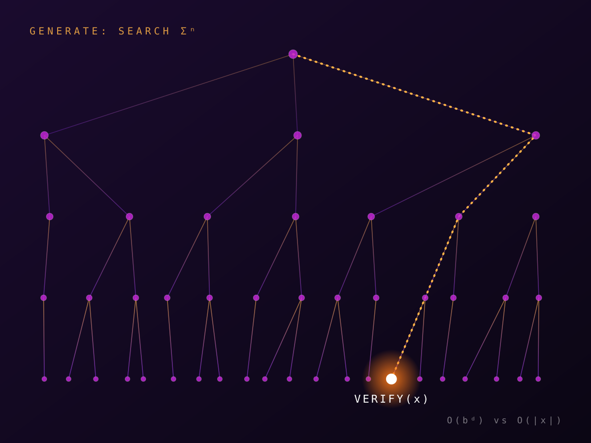

<!--
Card format
  ## Title                  starts a card
  kicker: / tags:           optional, directly under the heading
  > quote                   optional aside: a leading blockquote becomes the pull-quote...
     ...or a leading image line shows an image instead (caption optional)
                            image paths are relative to content/; put files in content/images/
  everything else           card body (Markdown; $inline$ and $$display$$ math via KaTeX)
-->

## The asymmetry of offense and defense
kicker: Thesis
tags: offense, verification

> AI's offensive capabilities do not translate to defensive ones

generation and verification: assuming that code generation is a walk over a state space AST trees, and code verification is performed on a single element of this space, we can see that the two problems are vastly different.

## Dolor sit exploitum
kicker: Observation
tags: search, witness

Duis sagittis ipsum. Praesent mauris. Fusce nec tellus sed augue semper porta. Mauris massa. Vestibulum lacinia arcu eget nulla. Class aptent taciti sociosqu ad litora torquent.

## Consectetur adversarium
kicker: Mechanism
tags: NP, certificates

Curabitur sodales ligula in libero. Sed dignissim lacinia nunc. Curabitur tortor. Pellentesque nibh. Aenean quam. In scelerisque sem at dolor. Maecenas mattis.

$$
\exists\, w \in \{0,1\}^{p(|x|)} : V(x, w) = 1
$$

Lorem ipsum dolor sit amet, consectetur adipiscing elit. Integer nec odio. Praesent libero. Sed cursus ante dapibus diam. Sed nisi. Nulla quis sem at nibh elementum imperdiet.

## Sed do defensio tempor
kicker: Counterpoint
tags: coNP, universal

Lorem ipsum dolor sit amet, consectetur adipiscing elit. Integer nec odio. Praesent libero. Sed cursus ante dapibus diam. Sed nisi. Nulla quis sem at nibh elementum imperdiet.

## Ut enim ad minima benchmark
kicker: Evidence
tags: evals, red-team

Duis sagittis ipsum. Praesent mauris. Fusce nec tellus sed augue semper porta. Mauris massa. Vestibulum lacinia arcu eget nulla. Class aptent taciti sociosqu ad litora torquent.

Curabitur sodales ligula in libero. Sed dignissim lacinia nunc. Curabitur tortor. Pellentesque nibh. Aenean quam. In scelerisque sem at dolor. Maecenas mattis.

## Quis nostrum vitrum
kicker: Conclusion
tags: glass, cannon

Curabitur sodales ligula in libero. Sed dignissim lacinia nunc. Curabitur tortor. Pellentesque nibh. Aenean quam. In scelerisque sem at dolor. Maecenas mattis.
